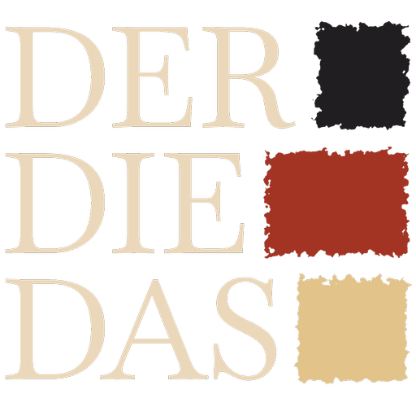
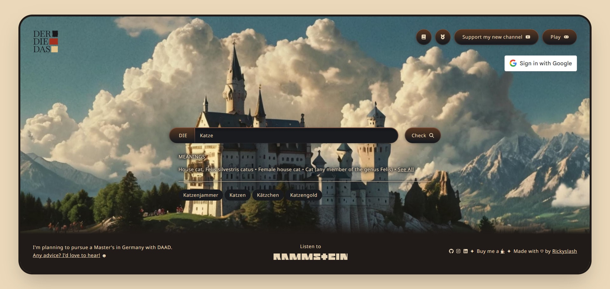

  

<h1 align="center">DerDieDas</h1>

  Learn German noun genders — search 88K+ nouns or play the ranked guessing game.

  
  
  
  
  
  

DerDieDas is a German noun-gender trainer. Search a noun to see its article (`der`, `die`, `das`), meanings, and similar words, or play the ranked guessing game and climb the global leaderboard.

This repository contains the frontend only. The API lives in the [backend repository](https://github.com/ricky-kiva/wrx-derdiedas-be).

## Screenshot

  

## Features

- Noun search across 88K+ German nouns, with meanings and similar-word matches.
- Ranked `der`/`die`/`das` guessing game with rule-based gender hints.
- Play as a guest, then sign in at the end to save the game's points.
- Global leaderboard with rank medals and pagination; points decay by 5 after 7 days without play.
- Google sign-in, display-name editing, point lookup, and account deletion.
- Responsive, animated UI built with Tailwind CSS, Framer Motion, and Lottie.

## Commands

| Command | Description |
| --- | --- |
| `npm run dev` | Start the Vite development server with HMR |
| `npm run build` | Type-check with `tsc -b` and build for production |
| `npm run preview` | Serve the production build locally |
| `npm run lint` | Run ESLint |

## Architecture

- `src/components` — layout and feature components for the header, search and game forms, matches, modals, and footer.
- `src/services` — typed API modules for auth, users, nouns, games, and the leaderboard.
- `src/lib/api` — the Axios instance plus request/response interceptors that attach the access token and refresh it, retrying the failed request once.
- `src/providers` — React context providers for auth, modals, and toasts.
- `src/hooks` — shared hooks, including the Zustand game store and responsive helpers.
- `src/types` — Zod schemas and TypeScript types for API payloads and domain models.
- `src/commons/config` — environment configuration resolved from `window.__RUNTIME_CONFIG__` or Vite's `VITE_*` variables.

The app has two routes: `/` for search and `/game` for the guessing game. The leaderboard, gender-rules note, and user profile open as modals from the header.

## Notes

### Container Deployments

For container deployments, `public/env/runtime-config.js.template` is rendered by `scripts/docker/env/replace-runtime-config.sh` at startup, so `API_BASE` and `GOOGLE_CLIENT_ID` can be supplied per environment without rebuilding the image.

© 2026 Ricky Fadel M. All rights reserved.